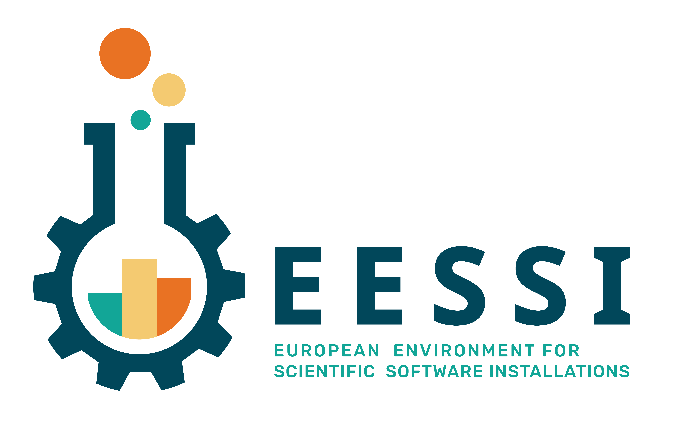

# EESSI

!!! tip "Updated version available!"

    This tutorial was held in Dec 2023, some aspects of it are now outdated.

    An updated version of this tutorial was presented in May 2025,
    see [here](https://eessi.io/docs/training-events/2025/tutorial-best-practices-cvmfs-hpc).

## European Environment for Scientific Software Installations

 

* [What is EESSI?](what-is-eessi.md)
* [Motivation & Goals](motivation-goals.md)
* [Inspiration](inspiration.md)
* [High-level design](high-level-design.md)
* [Using EESSI](using-eessi.md)
* [Getting support](support.md)
