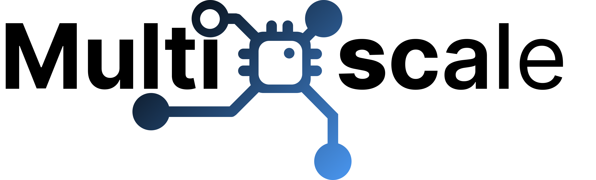

# Getting support for EESSI

!!! tip "Updated version available!"

    This tutorial was held in Dec 2023, some aspects of it are now outdated.

    An updated version of this tutorial was presented in May 2025,
    see [here](https://eessi.io/docs/training-events/2025/tutorial-best-practices-cvmfs-hpc).

Thanks to the funding provided by the [MultiXscale EuroHPC JU Centre-of-Excellence](../index.md#multixscale),
a dedicated support team is available to provide help on accessing or using EESSI.

If you have any questions, or if you are experiencing problems, do not hesitate to reach out
by either opening an issue in the [EESSI support portal](https://gitlab.com/eessi/support),
or sending an email to `support@eessi.io`.

For more information, see the [support section of the EESSI documentation](https://eessi.io/docs/support).

---

*(next: [CernVM-FS client system](../access/client.md))*
